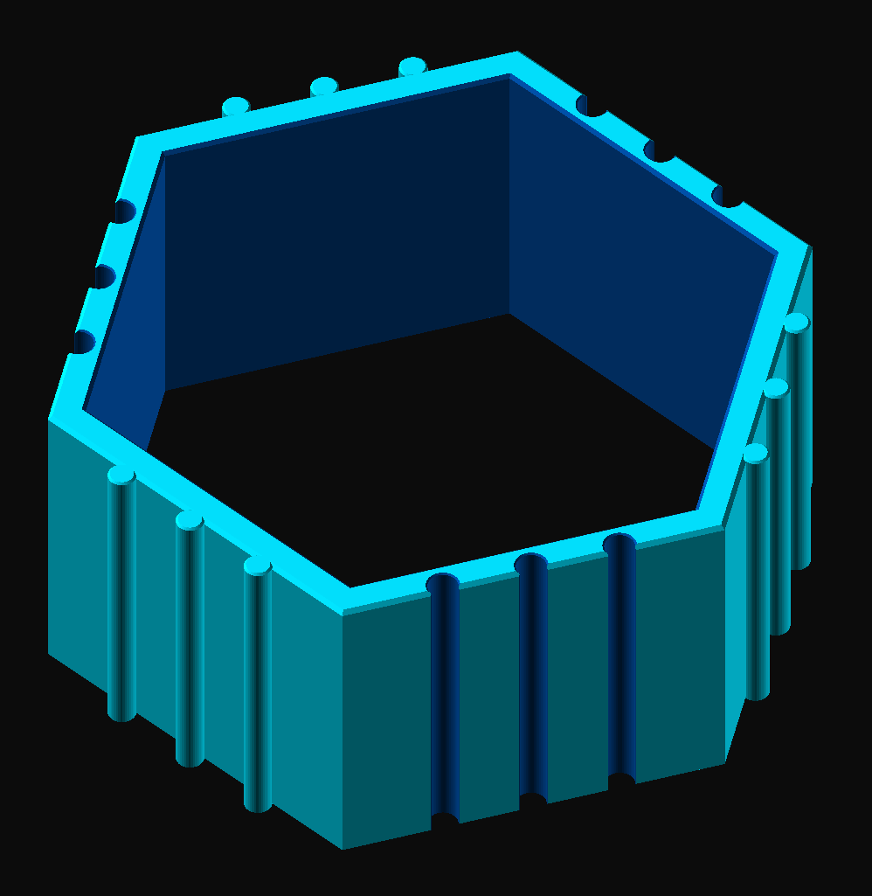

# Connectagon

A hollow hexagonal tile (extruded hexagon with thick walls) that interlocks with identical tiles in a honeycomb pattern.

> 

Each of the six walls carries three vertical cylinders:

- Three alternating walls have **grooves**: the cylinders are cut into the wall, 3/4 of their diameter deep.
- The other three walls have **ribs**: solid cylinders protruding 3/4 of their diameter from the wall.

Opposite walls are of opposite type, so a rib wall of one tile slides into the groove wall of its neighbor from above or the sides.

Print flat on the build plate; no supports are needed.
