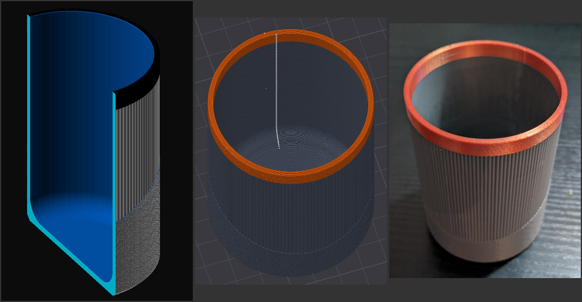
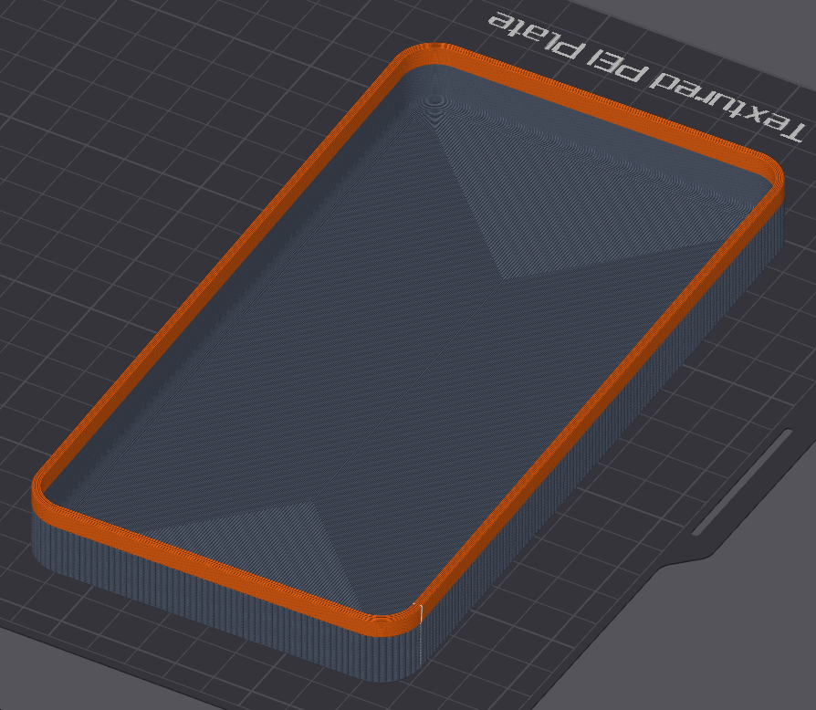

# Japandi

Minimalist, Japandi-inspired desk and home accessories.

## Pen Holder

> 

[pen-holder.scad](./pen-holder.scad) is a cylindrical pen holder. The inside of the floor has a concave fillet, so pens
slide to the centre and the cup has no sharp inner corner to trap dust or weaken the print.

The default model has a diameter of 65 mm and a height of 90 mm.

## Tray

[tray.scad](./tray.scad) is a rounded rectangular tray. Set `width` and `length` to change its outside footprint; wall thickness, floor thickness, floor fillet, and rim height are also adjustable.

The default model's dimensions are L190 × W100 × H20 mm.

> 

## Printing

Print the models upright with the open end on top; no supports are needed.
