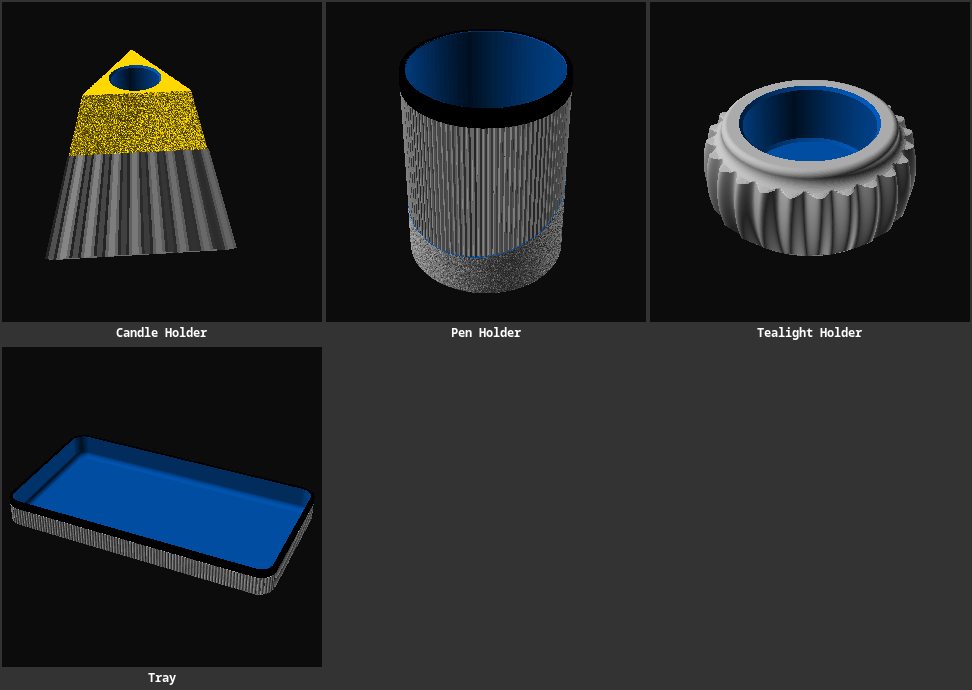
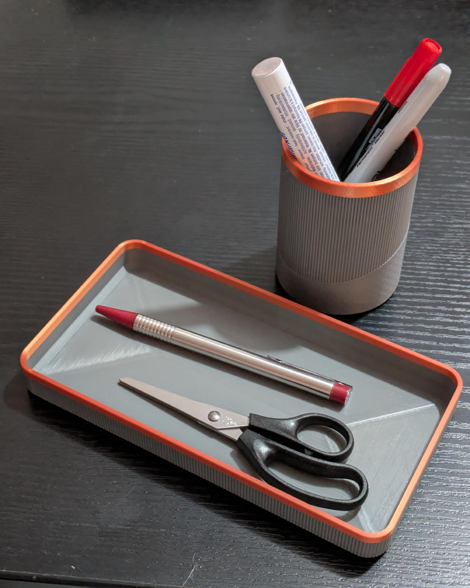
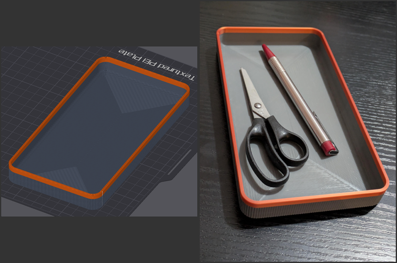
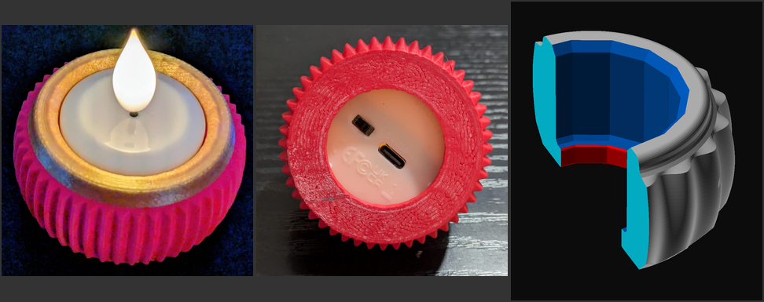
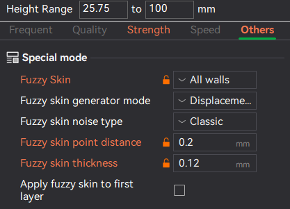

# Japandi <!-- omit from toc -->

> Minimalist, Japandi-inspired desk and home accessories.

> 

**Contents**

- [Pen Holder](#pen-holder)
- [Tray](#tray)
- [Candle Holder](#candle-holder)
- [Tea Light Holder](#tea-light-holder)
- [Printing](#printing)

> 

## Pen Holder

> 

[pen-holder.scad](./pen-holder.scad) is a cylindrical pen holder. The inside of the floor has a concave fillet, so pens
slide to the centre and the cup has no sharp inner corner to trap dust or weaken the print.

The default model has a diameter of 65 mm and a height of 90 mm.

## Tray

[tray.scad](./tray.scad) is a rounded rectangular tray. Set `width` and `length` to change its outside footprint; wall thickness, floor thickness, floor fillet, and rim height are also adjustable.

The default model's dimensions are L190 × W100 × H20 mm.

> 

## Candle Holder

[candle-holder.scad](./candle-holder.scad) is a three-sided pyramid with its tip cut off, leaving a flat top that holds the candle hole. The lower part has vertical flutes along the slope; the upper part has a rough texture and is exactly as high as the hole is deep.

- `base_side` and `height` set the side length of the triangular base and the total height.
- `hole_diameter` and `hole_depth` set the candle hole; `hole_depth` also sets the height of the rough section.
- `top_margin` is the material kept around the hole, which determines how much of the tip is cut off.
- `flute_count`, `flute_depth`, `bottom_chamfer` (bottom edge of the fluted section), `rough_depth` and `texture_size` adjust the textures.

The default model has a base side of 110 mm, a height of 100 mm, and a 22 × 30 mm candle hole.

## Tea Light Holder

[tealight-holder.scad](./tealight-holder.scad) is a fluted, rounded holder with a chamfered recess for a standard tea light.

> 

The default model is 64 mm in diameter and 30 mm tall, with a 40 × 25 mm recess.

> 🕳️ **Release & Access Hole**  The bottom of the tealight recess just has a rim to securely hold the tealight, but still allows easy releasing and accessing an on/off switch and charging port.

> 
>  Fuzzy Skin settings for the top (`Other` tab).

## Printing

Print both holders upright with the recess facing up; the candle holder stands on its triangular base, and the tea-light holder on its flat bottom. No supports are needed.
