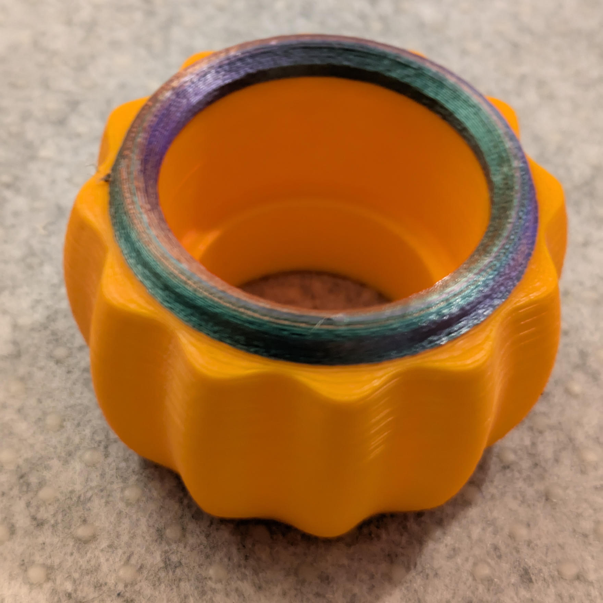

# Seasonal Models

## Pumpkin LED Tealight Holder

A fluted, pumpkin-shaped holder for a small LED tealight. The rounded body and
curved flutes are parametric, and the chamfered opening can be resized to fit
your LED tealight.

> 

Use a LED tealight only; this 3D-printed holder is not intended for a real flame.

## Printing

Print the holder upright on its flat base. At the default dimensions, supports should not be needed.

The opening is 39.5 mm in diameter and 25 mm deep by
default; adjust `hole_diameter` and `hole_depth` to fit your LED tealight.

## Files

- [pumpkin.scad](./pumpkin.scad) – Parametric OpenSCAD source; use OpenSCAD with the BOSL2 library installed to customize or render it.
- [pumpkin.3mf](./pumpkin.3mf) – Ready-to-slice model.
